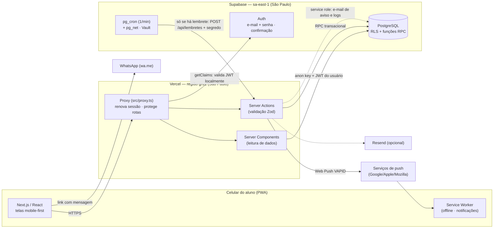
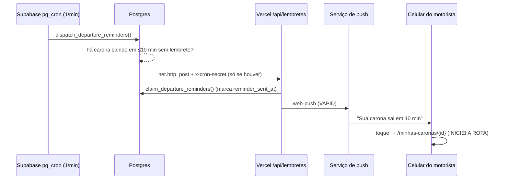
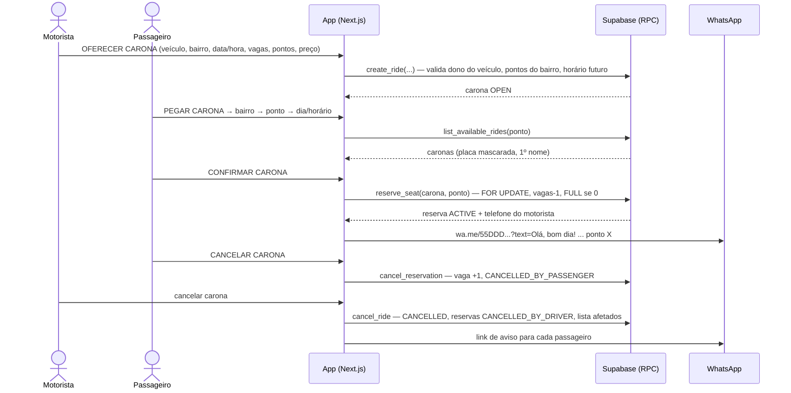

# Arquitetura

## Visão geral



## Decisões principais

| Decisão | Motivo |
|---|---|
| Next.js App Router + Server Actions | Um só projeto para telas e backend; validação no servidor sem API separada. |
| Supabase (Postgres + Auth + RLS) | Gratuito, com autenticação pronta e segurança por linha no próprio banco. |
| Mutações só por **funções RPC `SECURITY DEFINER`** | Reserva, cancelamento e criação de carona são atômicos; tabelas `rides`/`reservations` não têm política de escrita direta. |
| `SELECT ... FOR UPDATE` na carona | Serializa reservas concorrentes: impossível ocupar a mesma última vaga duas vezes. |
| Índice único parcial `reservations(ride_id, passenger_id) where status='ACTIVE'` | Impede reserva duplicada mesmo em corrida entre duas abas. |
| Placa mascarada no banco (`mask_plate`) | A placa completa nunca sai para terceiros (`vehicles` só é legível pelo dono). |
| `getClaims()` no proxy e nas páginas | Chaves JWT assimétricas (ES256): verificação local, sem ida ao servidor de Auth a cada clique. |
| Funções da Vercel em `gru1` | Mesmo país do banco (`sa-east-1`); antes rodavam em `iad1` (EUA) e cada clique cruzava o continente. |
| E-mail atrás de uma interface (`EmailProvider`) | Trocar Resend por outro provedor sem mexer em regra de negócio. |
| WhatsApp por link `wa.me` (sem API) | Gratuito e oficial; sem soluções não oficiais. Preparado para WhatsApp Cloud API no futuro. |
| Pontos com `latitude/longitude/endereço` **NULL** | Não inventar dados; `data_status = pending_data` até o cadastro real. |
| Notificações por **Web Push** do próprio app | Grátis e sem conta nova; Android no navegador ou instalado, iPhone só com o app instalado (iOS 16.4+). |
| Lembrete agendado no **Supabase** (`pg_cron` + `pg_net`) | A Vercel grátis só agenda 1×/dia; a checagem de cada minuto roda no banco e só chama a Vercel quando há lembrete. |
| Segredos das notificações no **Vault** do Supabase | Chaves VAPID e segredo do agendamento fora do código e sem configuração extra na Vercel. |
| Link público `/carona/{id}` com prévia sem dados pessoais | Cartão bonito no WhatsApp e novo aluno entende a carona antes de criar conta. |

### Lembrete de 10 minutos



## Fluxo motorista → carona → pontos → reserva → passageiro



## Organização do código

```text
src/
  proxy.ts                 proteção de rotas + renovação de sessão
  app/
    page.tsx               abertura (INSTALAR APP, Entrar, Criar conta)
    entrar, cadastro, verificar-email, esqueci-senha, nova-senha, auth/confirm
    pontos/                Pontos para bixetes (público)
    (app)/                 área logada com barra inferior
      inicio, perfil, veiculo, oferecer, pegar, reservas, minhas-caronas
      admin/               painel da conta oficial: bairros, pontos, fotos
      minhas-caronas/[id]  carona do motorista (destino do lembrete), INICIEI A ROTA
    carona/[rideId]        link público da carona (prévia + cartão do WhatsApp)
    api/lembretes          chamado pelo agendamento do Supabase
    api/push/chave         chave pública das notificações
    actions/               Server Actions (auth, profile, rides, reservations, search, admin, push, trips)
    manifest.ts            manifest do PWA
  components/              AppButton, StepHeader, RideCard, PickupPointCard, VehicleCard,
                           EmptyState/LoadingState, ConfirmationModal, BottomNavigation,
                           InstallPWAButton, InstallPrompt
  lib/                     supabase (server/proxy/admin), auth, admin, format, whatsapp, errors,
                           safe-next, geo, image, compress-image, notifications/email,
                           trip (janela dos botões), share, device, push/ (config, send, client, messages, endpoint)
supabase/migrations        schema, RLS e funções
tests/unit, scripts/       testes
```

## Preparação para o futuro

- **Rotas compartilhadas entre bairros:** `ride_pickup_points` guarda a ordem (`route_order`) dos pontos de
  cada carona; `pickup_points` já tem `latitude/longitude`. A interseção de pontos (ex.: Shopping) entre
  rotas de bairros diferentes pode ser consultada sem mudar o modelo.
- **Novos bairros:** basta inserir em `neighborhoods` e `pickup_points`; as telas listam do banco.
- **WhatsApp Business/Cloud API:** `notification_logs` já registra canal/status; basta um novo provedor.
