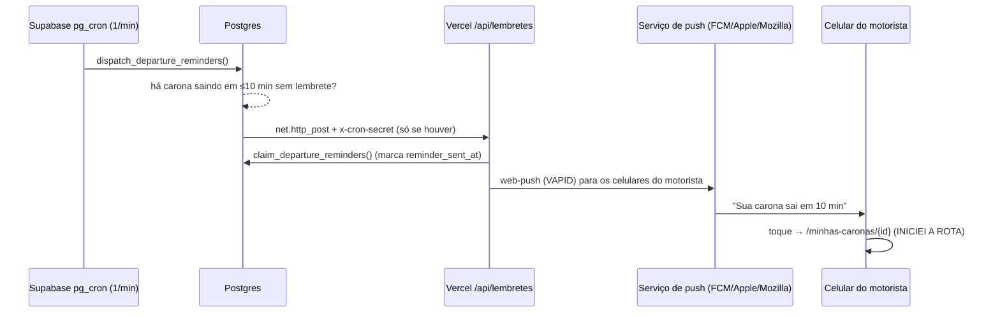

# Desenho — link da carona, "iniciei a rota", "estou no local" e lembrete de 10 min

**Data:** 25/09/2026 · **Status:** aprovado pelo responsável (seções 1–4) · **App:** Caronas UNIFAL

## Objetivo

1. O motorista compartilha a carona pelo WhatsApp com um link que leva direto a ela.
2. O motorista avisa os passageiros com **INICIEI A ROTA**.
3. O passageiro avisa o motorista com **ESTOU NO LOCAL**.
4. O motorista recebe uma notificação **10 minutos antes** da saída; tocar nela abre a carona no botão INICIEI A ROTA.

## Decisões do responsável

| Pergunta | Decisão |
|---|---|
| Link aberto por quem não está logado | **Prévia** (sem nome do motorista e sem placa) + ENTRAR / CRIAR CONTA; depois do login, direto na carona |
| Outra pessoa sem notificações ligadas | Mostrar quem foi avisado e oferecer **WhatsApp com mensagem pronta** para os demais |
| Lembrete sem passageiros | **Sempre** envia (texto diferente quando ninguém reservou) |
| Tecnologia das notificações | **Web Push do próprio app** (grátis, sem conta nova); agendamento no Supabase |
| Pedido extra (seção 1) | Deixar **aviso para ativar as notificações** também no fluxo do link |

## Restrições verificadas

- **Vercel Hobby:** tarefa agendada só **1 vez por dia** (precisão de ±59 min) → não serve para "10 min antes".
- **Supabase (grátis):** `pg_cron` roda a cada minuto e `pg_net` faz chamadas HTTP; segredos no **Vault**.
- **iPhone:** Web Push só com o app **instalado na tela inicial** (iOS/iPadOS 16.4+) e permissão pedida
  a partir de um toque em botão. Android: funciona no navegador e no app instalado.

## Arquitetura

- **Web Push (VAPID):** biblioteca `web-push` no servidor (Node). Chaves VAPID, segredo do agendamento
  e URL do app ficam no **Vault do Supabase** (`vapid_public_key`, `vapid_private_key`, `cron_secret`, `app_url`),
  lidos pelo servidor com a service role via `get_push_config()`. Nada novo na Vercel; nada no Git.
- **Service worker** (`public/sw.js`): eventos `push` (mostra a notificação e avisa a tela aberta para
  atualizar) e `notificationclick` (foca o app e abre a URL interna da notificação).
- **Custo:** a checagem de cada minuto roda dentro do Postgres; a Vercel só é chamada quando há lembrete.

## Banco de dados (migration `20260925000005_trips_push.sql`)

- `rides.started_at`, `rides.reminder_sent_at`, `reservations.arrived_at` (timestamptz, nulos).
- `push_subscriptions(id, user_id → auth.users on delete cascade, endpoint unique, p256dh, auth,
  user_agent, created_at, last_seen_at)`; RLS ligado, **sem grants** para anon/authenticated.
- RPCs (todas `SECURITY DEFINER`, `search_path = ''`):

| Função | Quem chama | O que faz |
|---|---|---|
| `save_push_subscription(endpoint, p256dh, auth, user_agent)` | usuário logado | Grava/reatribui o celular ao usuário atual. Endpoint `https` de serviço conhecido (googleapis, mozilla, apple, windows) |
| `delete_push_subscription(endpoint)` | usuário logado | Remove o celular se for do usuário (ao sair da conta) |
| `get_ride_preview(ride)` | anon e logado | Só campos seguros: sentido, saída, preço, vagas, status, bairro, pontos (nomes em ordem) |
| `start_ride(ride)` | motorista | Dono + carona ABERTA/LOTADA + janela (30 min antes até 60 min depois). Marca `started_at` uma vez; retorna `newly_started` e passageiros ativos |
| `mark_arrived(reserva)` | passageiro | Dono + reserva ATIVA + carona ativa + mesma janela. Marca `arrived_at` uma vez; retorna `newly_arrived` e dados do motorista |
| `claim_departure_reminders(p_only uuid[] = null)` | só service role | `UPDATE … RETURNING` atômico das caronas que saem em ≤10 min, sem lembrete, não iniciadas, criadas ≥10 min antes da saída; `p_only` restringe (testes) |
| `get_push_config()` | só service role | Lê chaves VAPID e `cron_secret` do Vault |
| `dispatch_departure_reminders()` | só pg_cron | Se houver carona devida, chama `app_url/api/lembretes` com `x-cron-secret` |

- `get_my_rides(p_ride_id uuid = null)` e `get_my_reservations()` recriadas com `started_at` e `arrived_at`.
- `pg_cron`: job `lembrete-saida-carona` (`* * * * *`) e limpeza diária do histórico do cron (7 dias).

## Telas e componentes

**Link da carona**
- `/carona/[rideId]` (público): `generateMetadata` com título/descrição/imagem para o cartão do WhatsApp.
  Logado → redireciona para `/pegar/carona/[id]`. Sem login → prévia + ENTRAR/CRIAR CONTA
  (`?next=/carona/[id]`) + aviso "depois de reservar, ative as notificações".
  Indisponível → "não está mais disponível" + VER OUTRAS CARONAS.
- `/pegar/carona/[rideId]` sem `ponto`: passo "Em qual ponto você vai esperar/descer?" com os pontos da carona.
- Cadastro leva o `next` até o fim: `/cadastro?next=` → e-mail → `/auth/confirm` → primeiro acesso → carona.
- `ShareRideButtons`: **COMPARTILHAR NO WHATSAPP** (`wa.me/?text=`) + **Copiar link**. Mensagem com sentido,
  dia/hora, preço, vagas, pontos, link e "ative as notificações no app para saber quando eu sair".
  Aparece em "Carona publicada!", em cada carona ativa de Minhas caronas e na página da carona.
- Imagem do cartão: `public/brand/og.png` (1200×630, logo do app). `metadataBase` no layout raiz a partir de
  `VERCEL_PROJECT_PRODUCTION_URL` (fallback `https://app-caronas-seven.vercel.app`).

**Notificações**
- `NotificationPrompt` (contexto: início, publicado, reservado, perfil): ATIVAR NOTIFICAÇÕES; iPhone sem
  app instalado → passos de instalação; bloqueado → dica de liberar nas configurações; "Agora não" no Início (7 dias).
- `PushSync` (layout logado): se a permissão já foi dada, regrava o celular para o usuário atual (1×/dia por
  usuário) e atualiza a tela quando chega uma notificação com o app aberto.
- Sair da conta remove o celular (antes do `signOut`).
- Ícone monocromático `public/brand/badge-96.png` para a barra do Android.

**Iniciei a rota / estou no local**
- `/minhas-caronas/[rideId]`: a carona sozinha (destino da notificação), com atualização automática.
- `RideItem`: botão **INICIEI A ROTA** (na janela), "Rota iniciada às 07:21", passageiros com
  "no local ✓ 07:25", resultado "avisado no celular ✓" ou **AVISAR NO WHATSAPP**; COMPARTILHAR; link para a página da carona.
- `ReservationItem`: "Motorista a caminho desde 07:21"; **ESTOU NO LOCAL** (na janela); "Motorista avisado ✓"
  ou WhatsApp "Olá! Já estou no ponto X" / "…no local combinado na UNIFAL".
- `AutoRefresh`: `router.refresh()` a cada 30 s enquanto houver carona na janela e ao voltar para o app.

**Textos das notificações**

| Evento | Título | Corpo | Abre |
|---|---|---|---|
| Lembrete (com passageiros) | 🚗 Sua carona sai em 10 min | 2 passageiros esperando. Toque para iniciar a rota. | `/minhas-caronas/{id}` |
| Lembrete (sem ninguém) | 🚗 Sua carona sai em 10 min | Ninguém reservou ainda. Toque para ver ou compartilhar. | `/minhas-caronas/{id}` |
| Rota iniciada (ida) | 🚗 {Motorista} iniciou a rota | Esteja no ponto {ponto} às {hora}. | `/reservas` |
| Rota iniciada (volta) | 🚗 {Motorista} iniciou a rota | Te encontro na UNIFAL às {hora}. Você desce em {ponto}. | `/reservas` |
| Chegada (ida) | 📍 {Passageiro} está no local | Esperando no ponto {ponto}. | `/minhas-caronas/{id}` |
| Chegada (volta) | 📍 {Passageiro} está no local | Esperando no local combinado na UNIFAL. | `/minhas-caronas/{id}` |

## Unidades novas (uma responsabilidade cada)

| Arquivo | Responsabilidade |
|---|---|
| `src/lib/trip.ts` | Janela dos botões (30 min antes / 60 min depois), igual à do banco |
| `src/lib/push/messages.ts` | Textos das notificações (puro, testável) |
| `src/lib/push/endpoint.ts` | Lista de serviços de push aceitos (puro, testável) |
| `src/lib/push/send.ts` | Envio via `web-push`, limpeza de celulares expirados (server-only) |
| `src/lib/whatsapp.ts` | + mensagens de compartilhar, rota iniciada e chegada; `wa.me` sem número |
| `src/app/actions/push.ts` | Salvar/remover o celular |
| `src/app/actions/trips.ts` | `startRoute`, `markArrived` (banco decide; servidor envia push; tela recebe WhatsApp de reserva) |
| `src/app/api/lembretes/route.ts` | Endpoint do agendamento (segredo, claim, envio) |
| `src/app/api/push/chave/route.ts` | Chave pública VAPID para o navegador |

## Erros e casos-limite

- Botão fora da janela: mensagem amigável ("disponível a partir de 30 min antes do horário").
- Apertar de novo: não reenvia aviso (banco guarda o primeiro horário).
- Celular expirado (404/410 do serviço de push): registro apagado; tela oferece WhatsApp.
- Falha da Vercel ao receber o agendamento: o lembrete não é marcado e o próximo minuto tenta de novo.
- Falha no envio depois de marcado: não reenvia (evita duplicar).
- Carona cancelada/lotada/que já saiu no link: página de indisponível.
- URL da notificação só é aceita se for caminho interno (`/…`).

## Segurança

- Autorização no banco (RPCs) como já acontece com reservas; servidor só repassa.
- `push_subscriptions` inacessível pela API pública; endpoint restrito a serviços de push conhecidos (evita
  o servidor ser usado para chamar endereços arbitrários).
- `/api/lembretes` exige `x-cron-secret` (comparação em tempo constante); segredos só no Vault.
- Prévia pública sem nome, placa ou telefone; ids das caronas são UUID (não adivinháveis).

## Testes

- **Unitários:** textos das notificações, mensagens de WhatsApp e link, janela dos botões, lista de serviços de push.
- **Integração (Supabase real):** só o motorista inicia; só o passageiro com reserva avisa chegada; fora da
  janela é recusado; segunda vez não "renova"; `claim` pega só as caronas certas e uma vez; funções
  restritas não são chamáveis por aluno/anônimo; prévia não expõe nome/placa; celular reatribuído ao trocar de conta.
- **Produção:** `/api/lembretes` sem segredo → 401; carona de teste vencendo → `reminder_sent_at` preenchido
  pelo agendamento real; páginas com contas temporárias.
- **Manual (responsável):** notificação chegando no Android e no iPhone com o app instalado.
- **Auditoria independente** antes de publicar; documentação (SETUP, DATABASE, TEST_REPORT, CHANGELOG, Obsidian).

## Fora do escopo (YAGNI)

Aviso de nova reserva ao motorista, push de cancelamento, chat, localização em tempo real do motorista.
