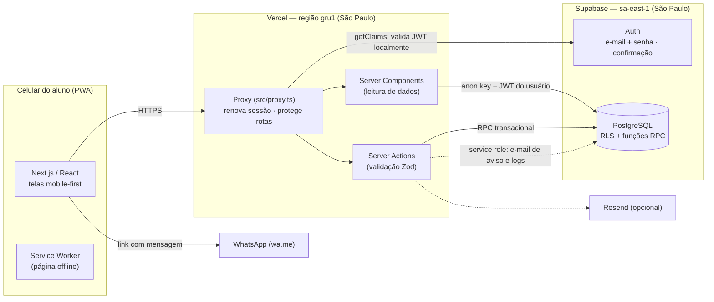

# Arquitetura

## Visão geral



## Decisões principais

| Decisão | Motivo |
|---|---|
| Next.js App Router + Server Actions | Um só projeto para telas e backend; validação no servidor sem API separada |
| Supabase (Postgres + Auth + RLS) | Gratuito, autenticação pronta, segurança por linha no banco |
| Mutações **só por funções RPC `SECURITY DEFINER`** | Reserva, cancelamento e criação de carona são atômicos |
| `SELECT ... FOR UPDATE` na carona | Serializa reservas concorrentes: impossível ocupar a mesma vaga duas vezes |
| Índice único parcial para reservas | Impede reserva duplicada mesmo em corrida entre abas |
| Placa mascarada no banco | Placa completa nunca sai para terceiros |
| `getClaims()` no proxy | Verificação local do JWT, sem ida ao servidor de Auth a cada clique |
| Funções Vercel em `gru1` | Mesmo país do banco (menos latência) |
| E-mail atrás de interface | Trocar Resend por outro provedor sem mexer em regra de negócio |
| WhatsApp por link `wa.me` | Gratuito e oficial; preparado para Cloud API no futuro |
| Pontos com `NULL` | Não inventar dados; `data_status = pending_data` até o cadastro real |

## Organização do código

```
src/
  proxy.ts                 proteção de rotas + renovação de sessão
  app/
    page.tsx               abertura (INSTALAR APP, Entrar, Criar conta)
    entrar, cadastro, verificar-email, esqueci-senha, nova-senha
    pontos/                Pontos para bixetes (público)
    (app)/                 área logada com barra inferior
      inicio, perfil, veiculo, oferecer, pegar, reservas, minhas-caronas
    actions/               Server Actions
    manifest.ts            manifest do PWA
  components/              AppButton, RideCard, PickupPointCard, etc.
  lib/                     supabase, auth, format, whatsapp, errors
supabase/migrations        schema, RLS, funções
```

## Preparação para o futuro

- **Novos bairros:** basta inserir em `neighborhoods` e `pickup_points`
- **Rotas compartilhadas:** `ride_pickup_points` guarda a ordem; pontos já têm `latitude/longitude`
- **WhatsApp Cloud API:** `notification_logs` já registra canal/status

---

**Veja também:** [[00 - Projeto]], [[05 - Banco de Dados]], [[06 - Fluxos]]
