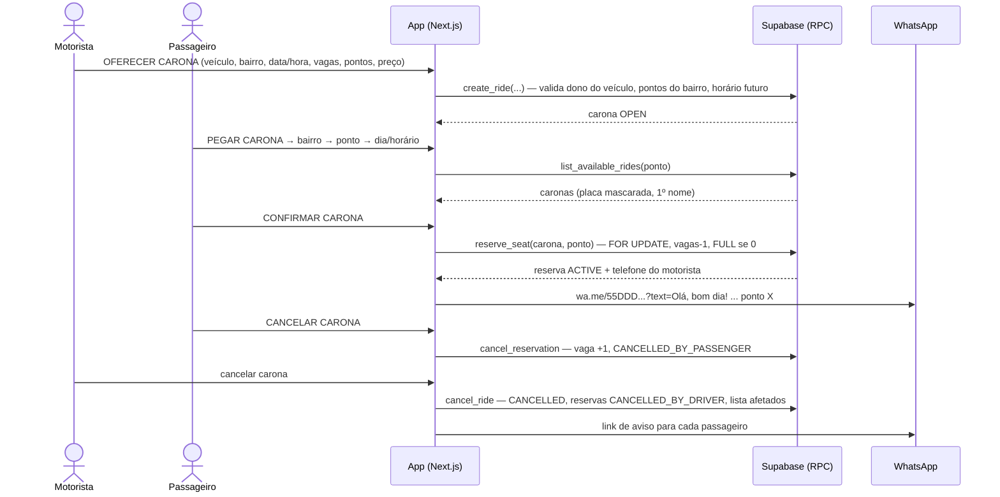
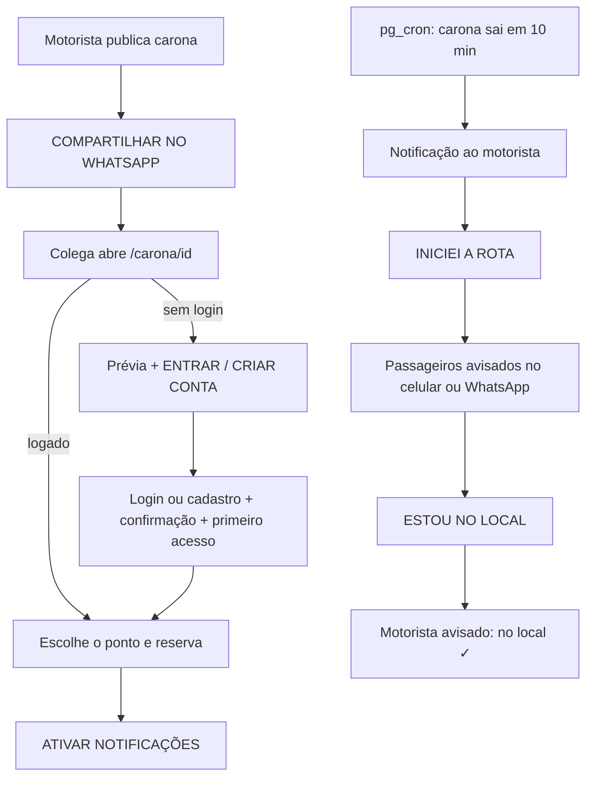

# Fluxos

## Fluxo principal: Motorista → Carona → Pontos → Reserva → Passageiro

## Wizard: Oferecer carona

1. **Veículo** — seleciona da lista (ou cadastra novo)
2. **Bairro** — lista de bairros ativos (hoje: Country Clube)
3. **Data/Hora** — seletor; valida horário futuro até 60 dias
4. **Vagas** — spinner de 1 a 8
5. **Pontos** — seleciona pontos do bairro em ordem; não pode repetir
6. **Preço** — valor em reais (0–1000)
7. **Resumo** — revisa tudo e confirma (grava na RPC `create_ride`)

## Wizard: Pegar carona

1. **Bairro** — seleciona bairro de destino
2. **Ponto de espera** — lista de pontos do bairro
3. **Dia/Horário** — seletor
4. **Resultados** — "Perto do seu horário" (±1 hora) e "Outros horários neste dia"
   - Card: 1º nome motorista, veículo, cor, preço, vagas, placa mascarada (ABC-***3)
   - Própria carona marcada como "Sua carona" (não reserva a si mesmo)
5. **Confirmação** — resume a carona e abre WhatsApp com mensagem automática por período (bom dia/boa tarde/boa noite)

## Mensagens automáticas

Saudação conforme o horário (bom dia até 12h, boa tarde até 18h, boa noite depois):

- **Reserva (ida):** "Olá, {bom dia}! Acabei de reservar uma carona de ida para a UNIFAL com você. Irei esperar no ponto {ponto}."
- **Reserva (volta):** "Olá, {bom dia}! Acabei de reservar uma carona de volta com você. Onde posso te encontrar? Irei descer no ponto {ponto}."
- **Rota iniciada (WhatsApp de reserva):** "Olá, {bom dia}! Iniciei a rota da carona. Chego no ponto {ponto} por volta das {hora}."
- **Chegada (WhatsApp de reserva):** "Olá! Já estou no ponto {ponto}."

## Link da carona, rota e chegada

- Botões liberados de **30 min antes até 1 h depois** do horário; cada aviso é enviado **uma vez só**.
- Quem não tem notificações (ex.: iPhone sem o app instalado) recebe pelo WhatsApp, com a mensagem pronta.

## Cancelamentos

**Passageiro cancela:**
- Só se reserva está `ACTIVE`
- Devolve a vaga (status volta a `OPEN` se for a última)
- Motivo: `CANCELLED_BY_PASSENGER`

**Motorista cancela:**
- Só se carona ainda não saiu
- Todas as reservas viram `CANCELLED_BY_DRIVER`
- Avisa passageiros por WhatsApp e e-mail (se configurado)

---

**Veja também:** [[04 - Arquitetura]], [[05 - Banco de Dados]], [[07 - Testes]]
